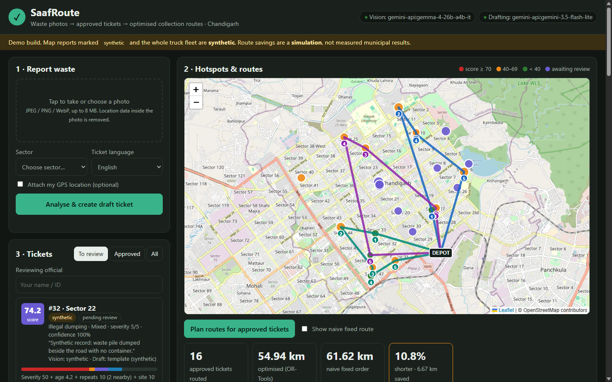
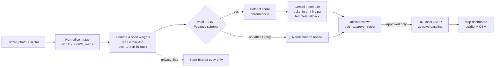

# SaafRoute

**Citizen waste photos → AI-checked tickets → officials approve → optimised collection routes.**
Built for *Code for Communities Chandigarh* (GDG Cloud Chandigarh), theme: Waste & Sustainability.

> **Honesty notice.** No official municipal data was available. The truck fleet, depot and the demo
> reports on the map are **synthetic** and labelled so in the app. The route-saving figure is a
> **simulation** on that synthetic data, never a measured municipal result. Sector locations are real
> (OpenStreetMap).



## What it does

1. **Report.** A citizen uploads a photo and picks their sector (GPS optional). Metadata in the photo is stripped.
2. **Understand the photo.** **Gemma 4**, Google's open-weight model (Apache-2.0), returns strict JSON:
   type (overflowing bin / illegal dump / litter / clean), material (aligned with India's SWM Rules 2016
   streams: mixed, dry, wet, construction debris, bulky, e-waste, hazardous), severity 1–5, confidence,
   a privacy flag and a one-line reason. Output is schema-validated. Invalid output gets one retry, then
   the report goes to **needs human review**. It never crashes and never guesses.
3. **Draft the ticket.** **Gemini** writes a short work ticket in **English, Hindi or Punjabi** from the
   structured facts (never from the photo), including the likely vehicle (e.g. a tipper for rubble).
   Offline templates take over if the API is unavailable.
4. **Human approval.** An official edits, approves or rejects. **The AI never dispatches anything.**
5. **Hotspot score (0–100).** A deterministic, explainable formula, with the breakdown shown on every ticket.
6. **Routes.** OR-Tools capacitated vehicle routing assigns approved tickets to trucks, compared with a
   naive fixed-order route over the same stops.

## Architecture



| Component | Choice | Why |
|---|---|---|
| Photo understanding | **Gemma 4 26B-A4B** (open weights, Apache-2.0) via Gemini API, falling back to Gemma 4 31B | Open-weight model doing the core work; same weights can be self-hosted by any city. Chosen by benchmark, see [docs/model-selection.md](docs/model-selection.md). |
| Ticket drafting | **Gemini 3.5 Flash-Lite** (→ 3.1 Flash-Lite → 2.5 Flash) | Clean Hindi/Punjabi drafts in our spot checks, ~2 s per ticket; Gemini 3.5 Flash was capped at 20 free requests/day, so Flash-Lite goes first. |
| Validation | Pydantic v2 | Strict schema, extra keys rejected. |
| Scoring | Plain Python | Explainable, testable, no model. |
| Routing | OR-Tools 9.15 CVRP, guided local search, 3 s limit | Standard, open source, handles capacity and drops low-priority stops if the fleet is full. |
| Distances | Haversine × 1.3 | Chandigarh's road grid makes travel ≈ 4/π ≈ 1.27 × straight-line on average. **Not road-network distances**, to keep setup simple. OSRM can be swapped into `routing.distance_matrix`. |
| API / storage | FastAPI + SQLite | No external services needed. |
| Frontend | Plain HTML/JS + Leaflet 1.9.4 (vendored) | Works on phones and projectors, no build step. |

### Hotspot score

`score = severity (10 per level, max 50) + age (up to 20, linear to 72 h) + repeats (5 per other open report within 300 m in 7 days, max 20) + site (10 for hospital/market/ISBT sectors 12, 16, 17, 22, 32, 43; else 5)`.
The sensitive-sector list is an assumption a municipality would maintain. See `saafroute/scoring.py`.

### Truck load assumption

Capacity units per ticket: litter 1, overflowing bin = severity, illegal dump = 2 × severity. Synthetic fleet: 3 trucks × 20 units, 1 depot (`data/fleet.json`).

## Measured results

Vision benchmark on **41 hand-labelled, openly licensed photos** (Wikimedia Commons, see
[data/ATTRIBUTION.md](data/ATTRIBUTION.md)). Full method and tables are in [docs/model-selection.md](docs/model-selection.md).

| | Gemma 4 26B-A4B (open, **chosen**) | Gemma 4 31B (open) | Gemini 3.5 Flash (closed, reference) |
|---|---|---|---|
| Images run / answered | 38 / 34 | 29 / 2 | 41 / 19 |
| Failures (all API errors; 0 invalid JSON) | 4 × 500 | 27 × 500/503 | 22 × 429 (20/day quota) |
| Kind accuracy (answered) | 85 % | 2/2 | 84 % |
| Severity within ±1 (answered) | 100 % | 2/2 | 89 % |
| Clean vs needs-collection (answered) | 100 % | 2/2 | 95 % |
| Median latency | 21 s | ~95 s | 9 s |

Run stopped early for the deadline (26B: 38 of 41 images). Gemma 4 31B was mostly unavailable on the
free API during testing, so its accuracy is unmeasured; it remains a fallback.

Route simulation (synthetic seed data, 16 approved tickets, 3 trucks): optimised **54.9 km** vs naive
fixed-order **61.6 km** (**10.8 % shorter**). This is a **simulation**. It will differ with real data,
road distances and real fleet constraints.

## Run it

Requirements: Python 3.11+ and a Gemini API key (free at https://aistudio.google.com/apikey).

```bash
git clone <repo-url> saafroute && cd saafroute
cp .env.example .env        # then put your key in .env as GEMINI_API_KEY=...
python run_demo.py          # creates .venv, installs pinned deps, seeds synthetic data, opens the browser
```

Windows: use `copy .env.example .env` and `python run_demo.py`.

**Offline mode** (no network at the venue): `python run_demo.py --offline`. Vision replays outputs
recorded from Gemma 4 during the benchmark (so the 41 benchmark photos in `data/bench/images/` still
work end-to-end), and drafting uses built-in templates. Any other photo goes to "needs human review".
Map tiles need the internet; offline, the map shows the sector grid on a plain background.

Other commands:

```bash
python run_demo.py --reset                 # wipe and re-seed the synthetic demo data
.venv/bin/python -m pytest -q              # tests (Windows: .venv\Scripts\python -m pytest -q)
.venv/bin/python scripts/benchmark.py --summary-only   # re-print benchmark numbers
```

Switch models without code changes in `config/models.yaml`, or with env vars
`SAAFROUTE_VISION_MODELS`, `SAAFROUTE_DRAFT_MODELS`, `SAAFROUTE_VISION_PROVIDER` (`gemini_hosted` |
`ollama` | `replay`), `SAAFROUTE_DRAFT_PROVIDER` (`gemini` | `template`).

## Scaling beyond Chandigarh

- **Any city:** sectors come from an OpenStreetMap query (`data/sectors.json`). Swap in another city's
  wards or neighbourhoods; the fleet is a small JSON file.
- **Indian categories:** waste types follow the SWM Rules 2016 segregation streams used by every urban local body.
- **Languages:** drafting already covers English, Hindi and Punjabi; adding Tamil, Marathi or Bengali is a
  config change to `LANG_NAMES` plus templates.
- **Data sovereignty and cost:** the vision model is open-weight, so a city can run it on its own server
  instead of a cloud API.

## Privacy and oversight

Photo metadata (including GPS) is stripped on upload; faces and number plates trigger storage of a blurred copy only; reports are anonymous;
every ticket needs an official's approval. Details and limits: [docs/privacy.md](docs/privacy.md).

## Known limits

- Synthetic fleet and demo reports; no municipal data or integration.
- Straight-line × 1.3 distances, not a road network.
- Free-tier Gemini API quotas are small (we hit a 20 requests/day limit on Gemini 3.5 Flash) and
  Gemma 4 31B returned frequent "high demand" errors during testing. A pilot needs a paid tier or self-hosting.
- Vision latency through the hosted API was tens of seconds per photo in our tests.
- Benchmark labels were made by a single annotator, the AI coding assistant (Claude) used to build this project, by looking at each photo **before** any model was run. They have not yet been checked by a human. The 41 images are not from Chandigarh. Treat the accuracy figures as indicative.
- No login or access control for officials yet.

## Licence

Code: [Apache-2.0](LICENSE). Benchmark images keep their own Creative Commons / public-domain licences ([data/ATTRIBUTION.md](data/ATTRIBUTION.md)).
Map data © OpenStreetMap contributors (ODbL).
